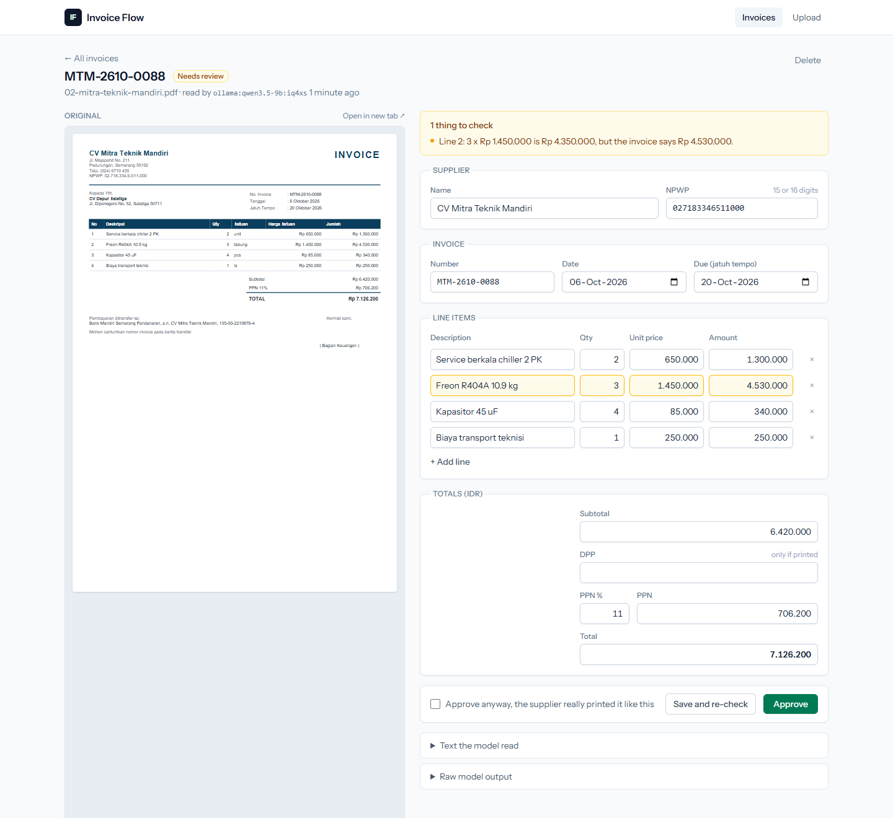

# Invoice Flow

[](https://github.com/ramaraihan12/invoice-flow/actions/workflows/ci.yml)

Upload a supplier invoice (PDF or photo), let an LLM pull the fields out, and have a person check anything that looks off before it goes to accounting. Built around Indonesian invoices: rupiah amounts, supplier NPWP, PPN, jatuh tempo.



That screenshot is a real run: `qwen3.5-9b` on Ollama read the sample PDF on the left. The sample has a line total that does not match 3 x 1.450.000, so the invoice lands in review with the line highlighted.

## How it works

- An upload is stored and a queued job reads it. Text PDFs go through `smalot/pdfparser`. Photos are sent to the model as images, but only if `INVOICE_LLM_VISION=true`.
- The text goes to the model through [Prism](https://prismphp.com) with a schema, so what comes back is a typed structure, not free text.
- A checker runs on the result and raises flags: line items that don't add up, PPN that doesn't match the rate, total that doesn't match, missing invoice number, bad NPWP length, and the same invoice number twice for one supplier.
- Everything lands in a review queue. You fix the fields next to the original file and approve. Flagged invoices need a tick on "approve anyway".
- Approving queues a webhook POST (retries with backoff, up to 6 tries). The body is signed with HMAC-SHA256 in `X-Invoice-Flow-Signature`, computed over `timestamp.body`. The timestamp is in `X-Invoice-Flow-Timestamp`. Receivers should check the signature and reject timestamps older than about 5 minutes.
- "Export approved to CSV" writes all approved invoices to one file and marks them exported. Import the NPWP column as text in Excel or Sheets, otherwise the leading zero (and the last digit of a 16-digit NPWP) gets lost.

## Stack

- PHP 8.4, Laravel 12, PostgreSQL, database queue
- Prism PHP: Ollama by default, or OpenAI, Gemini, Anthropic
- Blade + Tailwind 4 via Vite
- Pest, Pint, GitHub Actions, Docker

## Run it

You need PHP 8.4, Composer, Node, a Postgres database and [Ollama](https://ollama.com) with a model pulled.

```bash
createdb invoice_flow            # or create it however you like
cp .env.example .env
```

Edit `.env`: set the `DB_*` values and `INVOICE_LLM_MODEL` to a model you have pulled. Then install and migrate (safe to rerun if it stops halfway):

```bash
composer setup                   # installs, generates the key, runs migrations, builds assets
```

Run the web server and the queue worker in two terminals:

```bash
php artisan serve
php artisan queue:work --timeout=0
```

Open http://localhost:8000 and upload the PDFs from `samples/`. A 9B model on a laptop GPU can take a minute or two per invoice.

To use a hosted model, change these in `.env`:

| Variable | Meaning |
| --- | --- |
| `INVOICE_LLM_PROVIDER` | `ollama`, `openai`, `gemini` or `anthropic` |
| `INVOICE_LLM_MODEL` | model name for that provider |
| `INVOICE_LLM_VISION` | `true` if the model can read images |
| `OPENAI_API_KEY`, `GEMINI_API_KEY`, `ANTHROPIC_API_KEY` | key for the provider you picked |
| `INVOICE_WEBHOOK_URL`, `INVOICE_WEBHOOK_SECRET` | where approved invoices are sent, and the signing secret |

Everything else is in `.env.example`.

With Docker (web, queue worker and Postgres; Ollama stays on your host):

```bash
cp .env.example .env
echo "APP_KEY=base64:$(openssl rand -base64 32)"   # paste into .env, replacing the empty APP_KEY
docker compose up --build
```

The app is on http://localhost:8000. If your Ollama is somewhere else, set `DOCKER_OLLAMA_URL`.

The sample PDFs were made with `php artisan samples:generate`. All companies and numbers in them are made up. Two have deliberate mistakes and one is a resend of another, so each check has something to catch.

## Tests

```bash
vendor/bin/pest
vendor/bin/pint --test
```

The tests use `Prism::fake()` and `Http::fake()`, so they need no model and no API key. Locally they run on in-memory SQLite (needs `pdo_sqlite`). CI runs the same two commands against a Postgres service.

## Notes

- Quality depends on the model. A small local model misreads things now and then, which is why nothing is exported without a person approving it.
- Scanned PDFs without a text layer are rejected with a clear message. Send them as photos to a vision model instead, there is no OCR step.
- Currency is assumed to be IDR and amounts are whole rupiah.
- No login. It is meant to run on a private network. Add auth before putting it on the internet.
- Next: a Tesseract fallback for scanned PDFs, and per-supplier rules for known layouts.
